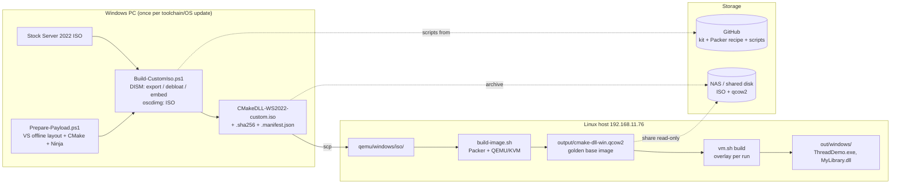
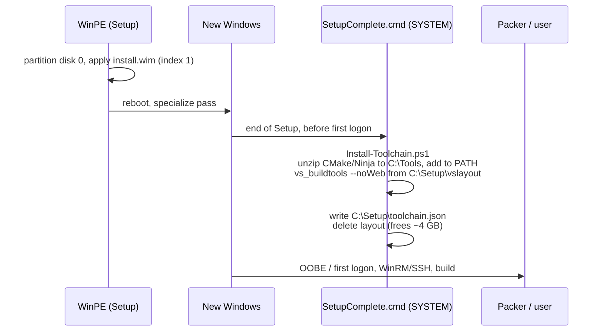

# Custom Windows Server 2022 ISO for CMake_DLL

This kit turns the stock Windows Server 2022 ISO into a build-ready ISO for
CMake_DLL. You run it on a Windows PC with only built-in tools (DISM) plus
`oscdimg` from the Windows ADK, similar to what NTLite does. The custom ISO
then goes to the Linux host (192.168.11.76), where Packer turns it into the
QEMU disk image.

> **Status:** this procedure has been run end to end on a Windows 11 PC with the
> Windows Server 2022 **evaluation** ISO (`SERVER_EVAL_x64FRE_en-us.iso`). It
> produced a 5.65 GB bootable ISO. See [Verified run](#3a-verified-run-reference-output)
> for the exact commands and output to expect.

The custom ISO differs from the stock one in these ways:

| | Stock ISO | Custom ISO |
|---|---|---|
| Editions | 4 (Standard/Datacenter × Core/Desktop) | 1 (default: Standard, Server Core) |
| Unneeded components | present | removed: WordPad, PowerShell 2.0, SMB1, XPS and Print-to-PDF features. IE, Media Player and Store/Xbox apps are also on the removal list but don't exist in Server Core, so they are skipped |
| Telemetry | on | off by policy; `DiagTrack` service disabled. (Search indexer, print spooler and other listed services are disabled only if present in the image.) |
| Build toolchain | none | VS 2022 Build Tools (MSVC + Windows SDK), CMake 4.1.2, Ninja 1.12.1, installed **offline** during Setup |
| Long paths | off | on (`LongPathsEnabled=1`) |
| Unattended install | no | optional (`-Unattended`) |

---

## 1. Overall process flow



| Stage | Where | Command | Time | Output |
|---|---|---|---|---|
| 1. Prepare payload | Windows PC | `Prepare-Payload.ps1` | 15–40 min | `<WorkDir>\payload\` (~2.5 GB) |
| 2. Inspect (optional) | Windows PC | `Build-CustomIso.ps1 -ListImages` / `-ListOnly` | 5 min | edition list / `<WorkDir>\report\*.csv` |
| 3. Build ISO | Windows PC | `Build-CustomIso.ps1` | 30–60 min | `<WorkDir>\out\CMakeDLL-WS2022-custom.iso` (~6 GB) |
| 4. Transfer | PC → .76 | `scp` | network bound | `qemu/windows/iso/` |
| 5. Build VM image | .76 | `./qemu/windows/build-image.sh` | 45–90 min | `output/cmake-dll-win.qcow2` |
| 6. Build project | .76 | `./qemu/windows/vm.sh build` | 2–3 min | `out/windows/` |

Stages 1–5 run once, and again only when you change the toolchain or Windows
version. Stage 6 is the everyday command.

`<WorkDir>` is any folder without spaces, for example `D:\isowork`. **Use the
same `-WorkDir` for stages 1–3**: the build looks for the payload inside it.

---

## 2. Requirements (Windows PC)

- Windows 10/11 or Server 2019+, x64, **elevated** PowerShell (5.1 or 7). Open
  *Windows PowerShell* with "Run as administrator".
- Internet access for stage 1 (Microsoft and GitHub downloads)
- About **40 GB** free on the work drive. The work directory path must not
  contain spaces.
- **Windows ADK, Deployment Tools feature only.** It provides `oscdimg.exe`,
  which writes the ISO file. This installs only that feature (about 100 MB):
  ```powershell
  winget install Microsoft.WindowsADK --override "/features OptionId.DeploymentTools /quiet /norestart"
  Test-Path "${env:ProgramFiles(x86)}\Windows Kits\10\Assessment and Deployment Kit\Deployment Tools\amd64\Oscdimg\oscdimg.exe"   # must print True
  ```
  Without `winget`, download the ADK installer from Microsoft and tick only
  **Deployment Tools**. `Build-CustomIso.ps1` checks for `oscdimg` at the start
  and stops immediately if it is missing.
- Source ISO: **Windows Server 2022** (English, x64), either the evaluation
  from the Microsoft Evaluation Center or your licensed media.

Get the kit, then allow its scripts **in each new PowerShell window** (the
setting lasts only for that window; it changes nothing permanent):

```powershell
git clone https://github.com/JohnBlue-firm/CMake_DLL.git
cd CMake_DLL\qemu\windows\iso-kit
Set-ExecutionPolicy -Scope Process -ExecutionPolicy Bypass -Force
Get-ChildItem ..\..\.. -Recurse | Unblock-File
```

If you see "running scripts is disabled on this system", you skipped
`Set-ExecutionPolicy` in the current window. You can also run a single script
with `powershell -NoProfile -ExecutionPolicy Bypass -File .\Prepare-Payload.ps1 -WorkDir D:\isowork`.

---

## 3. Step by step

### Step 1: prepare the payload

```powershell
.\Prepare-Payload.ps1 -WorkDir D:\isowork
```

This step:

1. Downloads CMake and Ninja from GitHub and verifies them against the SHA-256
   values pinned in `config\toolchain.psd1`.
2. Downloads `vs_buildtools.exe` and runs
   `--layout D:\isowork\payload\vslayout --add VCTools --includeRecommended --add VC.CMake.Project --lang en-US`.
   That creates a complete **offline installer** for MSVC, the Windows SDK and
   the VS CMake integration.
3. Writes `payload\payload.json`, which records the versions that went in.

Expected output ends with `Payload ready: D:\isowork\payload (2.52 GB)`, and
the folder then contains `tools\`, `vslayout\` and `payload.json`. Re-running
reuses existing downloads and updates the VS layout in place. Re-run it whenever
you want newer MSVC versions.

### Step 2 (optional): inspect the edition

```powershell
.\Build-CustomIso.ps1 -SourceIso D:\iso\server2022.iso -ListImages
.\Build-CustomIso.ps1 -SourceIso D:\iso\server2022.iso -ListOnly
```

- `-ListImages` prints the editions on the ISO. The default name,
  `Windows Server 2022 SERVERSTANDARDCORE`, matches **retail/volume** media only.
  **Evaluation** ISOs use different names, so pick by index:
  ```
  [1] Windows Server 2022 Standard Evaluation                         <- Server Core (recommended)
  [2] Windows Server 2022 Standard Evaluation (Desktop Experience)
  [3] Windows Server 2022 Datacenter Evaluation
  [4] Windows Server 2022 Datacenter Evaluation (Desktop Experience)
  ```
  Use `-ImageIndex 1`, or `-ImageName '<exact name>'`.
- `-ListOnly` mounts the chosen edition and writes `report\appx.csv`,
  `report\capabilities.csv` and `report\features.csv` (the Appx list is empty on
  Server Core), then discards the
  mount without changing anything. Use these files to adjust
  `config\debloat.psd1`.

### Step 3: build the custom ISO

```powershell
.\Build-CustomIso.ps1 -SourceIso D:\SERVER_EVAL_x64FRE_en-us.iso -WorkDir D:\isowork -ImageIndex 1 -Clean
```

`-Clean` first resets the work folders (see [Starting over](#starting-over)), so
every run starts from a known state. **Don't press Ctrl+C while it runs**:
an interrupted DISM mount leaves locked files behind (`Clean-Workdir.ps1` fixes
that).

What happens, in order (each stage is logged to `D:\isowork\logs\`):

| # | Action | Tool |
|---|---|---|
| 1 | Mount the source ISO and copy its files to `<WorkDir>\iso` | `Mount-DiskImage`, robocopy |
| 2 | Export **only the selected edition** to a new `install.wim`, which drops the other 3 editions | `Export-WindowsImage` |
| 3 | Mount `install.wim` at `<WorkDir>\mount` | `Mount-WindowsImage` |
| 4 | Remove provisioned Appx packages matching `AppxPatterns` (Xbox, Bing, ...). **Skipped automatically on Server Core**, which has no Appx/Store stack | `Remove-AppxProvisionedPackage` |
| 5 | Remove capabilities matching `CapabilityPatterns` (IE, WMP, WordPad, ...) | `Remove-WindowsCapability` |
| 6 | Disable optional `Features` **and delete their payload** | `Disable-WindowsOptionalFeature -Remove` |
| 7 | Load the offline SOFTWARE/SYSTEM hives: disable `DisableServices`, apply `Registry` policies (telemetry off, long paths, Defender exclusions, ...) | `reg load/add/unload` |
| 8 | Shrink the component store | `dism /Cleanup-Image /StartComponentCleanup /ResetBase` |
| 9 | Embed `C:\Setup\` (VS layout, CMake/Ninja zips, `Install-Toolchain.ps1`, `toolchain.psd1`) and `C:\Windows\Setup\Scripts\SetupComplete.cmd` | file copy |
| 10 | Save and unmount, then **re-export** with max compression so deleted payload space is actually freed | `Dismount-WindowsImage -Save`, `Export-WindowsImage` |
| 11 | With `-Unattended`: write `autounattend.xml` to the ISO root and use the UEFI "no key press" boot loader | template |
| 12 | Build a BIOS + UEFI bootable UDF ISO | `oscdimg -m -o -u2 -udfver102 -bootdata:2#...` |
| 13 | Write `<iso>.sha256` and `<name>.manifest.json`, which list exactly what was removed or added | `Get-FileHash` |

Useful switches:

| Switch | Effect |
|---|---|
| `-RemoveDefender` | Also removes Microsoft Defender. Builds get faster, but the VM has no antivirus. |
| `-ImageIndex <n>` / `-ImageName '<name>'` | Which edition to keep (use `-ListImages` to see them) |
| `-Clean` | Reset the work folders (not the payload) before building |
| `-SkipDebloat` / `-SkipToolchain` / `-SkipCleanup` | Skip that stage |
| `-Unattended -AdminPassword '...' [-ProductKey ...]` | The ISO installs itself without questions. **It wipes disk 0 of any machine that boots it.** Build the ISO you give to QEMU/Packer **without** this switch, because Packer supplies its own answer file. |
| `-OutputIso D:\out\name.iso` | Output path (default `<WorkDir>\out\CMakeDLL-WS2022-custom.iso`) |

### Starting over

`Clean-Workdir.ps1` dismounts leftover images, runs `dism /Cleanup-Wim`, and
deletes work folders even when permissions are locked (it takes ownership
first). Run it from an elevated PowerShell:

```powershell
.\Clean-Workdir.ps1 -WorkDir D:\isowork          # removes iso, mount, report, out, install.wim; keeps payload and logs
.\Clean-Workdir.ps1 -WorkDir D:\isowork -All     # also removes payload, logs and vs_buildtools.exe
```

The payload doesn't change between runs, so use `-All` only when you want to
re-download everything (for example after changing `config\toolchain.psd1`).
A complete restart from nothing:

```powershell
.\Clean-Workdir.ps1 -WorkDir D:\isowork -All
.\Prepare-Payload.ps1 -WorkDir D:\isowork
.\Build-CustomIso.ps1 -SourceIso D:\SERVER_EVAL_x64FRE_en-us.iso -WorkDir D:\isowork -ImageIndex 1
```

### Step 4: what happens when the ISO is installed



MSVC is installed at this point, not baked into `install.wim`, because the
Visual Studio installer only runs on a live Windows system: it registers
instances, COM components and services. The install still needs **no
internet**, because everything comes from `C:\Setup`.

Results inside the installed Windows:

- `C:\BuildTools`: MSVC, Windows SDK, VS-bundled CMake
- `C:\Tools\cmake\bin`, `C:\Tools\ninja`: on the machine `PATH`
- `C:\Setup\toolchain.json`: written on success. On failure you get
  `C:\Setup\toolchain.FAILED`, with details in `C:\Setup\logs\`.

To check the ISO by hand, install it once in Hyper-V or VirtualBox, log in,
and run:

```powershell
Get-Content C:\Setup\toolchain.json
cmake --version
& "${env:ProgramFiles(x86)}\Microsoft Visual Studio\Installer\vswhere.exe" -products * -format text
```

### Step 5: transfer to the Linux host

Copy all three files together. (Windows 10/11 include `scp`; or use WinSCP.) The Linux side uses the `.sha256` to verify the
ISO and the `.manifest.json` to recognize it as a custom ISO.

```powershell
cd D:\isowork\out
scp CMakeDLL-WS2022-custom.iso CMakeDLL-WS2022-custom.iso.sha256 CMakeDLL-WS2022-custom.manifest.json `
    yujen@192.168.11.76:~/CMake_DLL/qemu/windows/iso/
```

On .76:

```sh
cd ~/CMake_DLL/qemu/windows/iso && sha256sum -c CMakeDLL-WS2022-custom.iso.sha256
```

### Step 6: build the QEMU image and the project (on .76)

```sh
cd ~/CMake_DLL
./qemu/windows/build-image.sh       # picks iso/CMakeDLL-WS2022-custom.iso automatically
./qemu/windows/vm.sh build          # -> out/windows/
```

`build-image.sh` detects the manifest, selects image index 1, verifies the
checksum, and runs Packer. Packer's `install-buildtools.ps1` sees that MSVC is
already installed and skips the download, so the only network access during the
VM build is the OpenSSH download. See [`../../README.md`](../../README.md) for
details on `vm.sh`.

---

## 3a. Verified run (reference output)

Commands used, in an elevated PowerShell on Windows 11, with the evaluation ISO
at `D:\SERVER_EVAL_x64FRE_en-us.iso`:

```powershell
winget install Microsoft.WindowsADK --override "/features OptionId.DeploymentTools /quiet /norestart"
Set-ExecutionPolicy -Scope Process -ExecutionPolicy Bypass -Force
.\Clean-Workdir.ps1 -WorkDir D:\isowork -All
.\Prepare-Payload.ps1 -WorkDir D:\isowork
.\Build-CustomIso.ps1 -SourceIso D:\SERVER_EVAL_x64FRE_en-us.iso -WorkDir D:\isowork -ImageIndex 1 -Clean
```

What a good run prints (abridged):

```
==> Mounting source ISO D:\SERVER_EVAL_x64FRE_en-us.iso
    Edition: [1] Windows Server 2022 Standard Evaluation
==> Copying ISO contents to D:\isowork\iso
==> Exporting the selected edition to a new install.wim
==> Mounting install.wim at D:\isowork\mount
    Appx provisioning not available in this image (normal for Server Core): skipping
==> Removing capabilities
    remove Microsoft.Windows.WordPad~~~~0.0.1.0
==> Disabling and removing optional features
    remove MicrosoftWindowsPowerShellV2 / Printing-PrintToPDFServices-Features /
           Printing-XPSServices-Features / SMB1Protocol
==> Offline registry: services and policies
    disable service DiagTrack ... LongPathsEnabled = 1 ... Defender exclusions
==> Component store cleanup (/StartComponentCleanup /ResetBase)
==> Embedding toolchain payload into C:\Setup
==> Saving and unmounting install.wim
==> Re-exporting install.wim (drops deleted payload, max compression)
==> Building D:\isowork\out\CMakeDLL-WS2022-custom.iso
    ... Image file is 6067900416 bytes ... Done.
==> Done
    ISO:      D:\isowork\out\CMakeDLL-WS2022-custom.iso (5.65 GB)
    SHA-256:  9e3c0662cbbedd4dfca90fe3e09085a228bcc73a5e4d99cf1553d165962882de
    Manifest: D:\isowork\out\CMakeDLL-WS2022-custom.manifest.json
```

Results of that run:

| Item | Value |
|---|---|
| Payload (`Prepare-Payload.ps1`) | 2.52 GB (VS offline layout + CMake 4.1.2 + Ninja 1.12.1) |
| Custom ISO | 6,067,900,416 bytes (5.65 GB), BIOS + UEFI bootable |
| Edition kept | `Windows Server 2022 Standard Evaluation` (Server Core, build 10.0.20348) |
| Removed | WordPad, PowerShell 2.0, SMB1, XPS Viewer/Print-to-XPS and Print-to-PDF features |
| Disabled / set | `DiagTrack`; telemetry policy off; Server Manager auto-start off; GameDVR off; long paths on; Defender exclusions for `C:\work`, `C:\BuildTools`, `C:\Tools` |

Server Core ships very little to remove, so the main size savings come from
keeping a single edition and from `/ResetBase`. Your SHA-256 will differ from
the one above (the ISO contains timestamps); what matters is that the `.sha256`
file next to your ISO matches the copy on the Linux host.

---

## 4. Storage and versioning

| Artifact | Size | Store in | Why |
|---|---|---|---|
| This kit, Packer template, scripts | KB | **GitHub** (this repo) | Small and reviewable. They reproduce everything else. |
| `payload.json`, `*.manifest.json` | KB | GitHub (optional, e.g. `qemu/windows/iso/manifests/`) | Records exactly what each ISO contains |
| Custom ISO + `.sha256` | ~6 GB | NAS / shared disk | Over GitHub's file limits, and contains Windows (license) |
| `cmake-dll-win.qcow2` | ~10–15 GB | NAS / shared disk, read-only | Same reasons. `vm.sh` only reads it (`IMAGE=/nas/... ./vm.sh build`). |

Suggested naming for releases on the NAS:
`CMakeDLL-WS2022-<yyyymmdd>.iso` / `.qcow2`. Commit the matching
`.manifest.json`, then tag the repo (`git tag vm-20261028`) so every image can be
traced back to the exact scripts that built it.

---

## 5. Customizing

| To change | Edit |
|---|---|
| CMake / Ninja version | `config\toolchain.psd1`: `Url` + `Sha256` (from the release's `SHA-256.txt`) |
| VS components (e.g. ARM64, Clang) | `config\toolchain.psd1`: `Components`, then re-run `Prepare-Payload.ps1` |
| What gets removed | `config\debloat.psd1` (use the `-ListOnly` CSVs) |
| Edition (e.g. Desktop Experience) | `-ImageIndex 2` (evaluation ISO) or `-ImageName 'Windows Server 2022 SERVERSTANDARD'` (retail) |
| Answer file used with `-Unattended` | `unattend\autounattend.template.xml` |

Note on "Xbox": Windows Server doesn't ship Xbox, Store or consumer apps. Those
patterns exist in `debloat.psd1` so the same list also works for client
editions, and on Server they simply match nothing. Most of the size reduction on
Server comes from dropping the other editions, removing feature payloads, and
`/ResetBase`.

---

## 6. Troubleshooting

| Symptom | Cause / fix |
|---|---|
| "running scripts is disabled on this system" | Run `Set-ExecutionPolicy -Scope Process -ExecutionPolicy Bypass -Force` in **that** window (it doesn't carry over to new windows), then `Get-ChildItem ..\..\.. -Recurse \| Unblock-File`. |
| `Edition not found on the ISO` | Evaluation ISOs use other names. Run `-ListImages`, then pass `-ImageIndex 1` (Server Core). |
| Build can't find the payload / "Missing ...tools" | `-WorkDir` differs between `Prepare-Payload.ps1` and `Build-CustomIso.ps1`. Use the same folder for both. |
| `Remove-Item ... PCL5ERES.DLL ... access denied` on `mount\` | An earlier run was interrupted and left locked files. Run `.\Clean-Workdir.ps1 -WorkDir <dir>` (it takes ownership and deletes them). `Build-CustomIso.ps1` now does this itself. If it still fails, reboot and run it again. |
| `Get-AppxProvisionedPackage : The specified module could not be found` | Server Core has no Appx stack. Fixed: the script now prints "Appx provisioning not available ... skipping" and continues. |
| `oscdimg.exe not found` | Install the ADK **Deployment Tools** feature (see Requirements). The script checks this first, so it fails within seconds. |
| Script stopped, mount left behind | `.\Clean-Workdir.ps1 -WorkDir <dir>`. By hand: `dism /Get-MountedWimInfo`, `dism /Unmount-Wim /MountDir:<dir>\mount /Discard`, `dism /Cleanup-Wim`. |
| `could not unload HKLM\CDLL_*` | Close Regedit or any other program that has the hive open, then run `reg unload HKLM\CDLL_SOFTWARE` (and `CDLL_SYSTEM`). |
| Feature/capability "could not remove" warning | It is a dependency of something else; it is skipped and the build continues. |
| VM build: "toolchain install failed during Windows Setup" | Check `C:\Setup\logs\Install-Toolchain.log` and `dd_*.log` in the VM (`HEADLESS=false` or VNC). The usual cause is a layout made with different components than `toolchain.psd1`, so re-run `Prepare-Payload.ps1`. |
| Antivirus slows `Build-CustomIso.ps1` | Exclude the work folder (for example `D:\isowork`) from real-time scanning on the PC. |

## 6a. Files in this kit

| File | Purpose |
|---|---|
| `Prepare-Payload.ps1` | Step 1: download the VS offline layout, CMake and Ninja |
| `Build-CustomIso.ps1` | Step 3: debloat, embed the toolchain, write the ISO |
| `Clean-Workdir.ps1` | Reset the work folders; fixes interrupted or locked mounts |
| `config\toolchain.psd1` | Versions, URLs and SHA-256 values of what gets embedded |
| `config\debloat.psd1` | What gets removed or disabled |
| `payload\Setup\SetupComplete.cmd`, `Install-Toolchain.ps1` | Run inside the new Windows at the end of Setup |
| `unattend\autounattend.template.xml` | Answer file for `-Unattended` |

## 7. Licensing and security

- The custom ISO and the qcow2 are copies of Windows and of Microsoft Build
  Tools. Keep them on internal storage. Evaluation media is for evaluation only
  (180 days); for long-term use, build from licensed media with a product key.
- The VS Build Tools license requires a valid Visual Studio license for the
  people using the compiler. Check this with your organization.
- If you use `-Unattended`, `autounattend.xml` contains the Administrator
  password in plain text. Don't reuse a real password.
